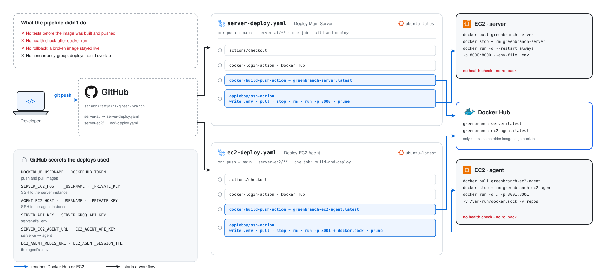

# GreenBranch - Automated Test Repair for GitHub Repositories

## Overview

GreenBranch fixes failing test suites. Point it at a GitHub repository and it:
- Clones the repository and runs your own install and test commands
- Picks a failing test, finds the code behind it, and asks an LLM for a small edit
- Re-runs the tests and keeps the edit only if the error it targeted is gone; otherwise it reverts the file
- Repeats until every test passes or the test-run limit is reached
- Pushes the kept edits to a new `greenbranch/fix-…` branch and opens a pull request for you to review

Your default branch is never pushed to, and every step streams to the browser as it happens.

Live at **[greenbranch.abhiramtech.in](https://greenbranch.abhiramtech.in)**.

## Features

**Running a fix:**
- Pick one of your repositories after signing in with GitHub, or paste any public repository URL without an account
- Node.js and Python projects; the install command, test command and number of test runs are editable per run
- A live view of every step: each test run, each edit (kept or reverted), the commit and the pull request
- For every kept edit: the failing test, the root cause, what changed and the commit message
- The full log, searchable, with copy and download

**Safety:**
- Edits are verified by the next test run before they are kept
- Edits to test assertions are rejected, so a test can't be "fixed" by weakening it
- The GitHub token and the backends' API keys never reach the browser; the browser only holds a single-use `run_id`
- Runs are saved in your browser, so the history needs no account or database

## Tech Stack

### Frontend
- **Next.js 16** (React 19, App Router, server routes)
- **TypeScript**
- **Tailwind CSS 4** and **shadcn/ui** (Radix UI)
- **NextAuth.js** (GitHub OAuth)

### Backend
- **server-ai**: Python, **FastAPI**, Uvicorn. Runs the test/fix loop and streams it over a WebSocket
- **server-runner**: Python, **FastAPI**, GitPython. Clones repositories, runs install and test commands, writes files, commits and pushes
- **Groq API** (`openai/gpt-oss-120b`) for the edits
- **Redis** for server-runner's sessions
- **uv** for Python dependencies

### Infrastructure
- **Vercel** (frontend)
- **Android phone, Termux + proot-distro Debian** (both backends)
- **PM2** (keeps the backends, Redis and the tunnel running)
- **Cloudflare Tunnel + Access** (public URL for server-ai, and authenticated SSH for deploys)
- **GitHub Actions** (CI/CD)
- **Docker** (optional executor containers for server-runner, and images for other hosts)

## Architecture


1. **Browser → Vercel**: the pages and the Next.js server routes. `/api/runs` registers a run on server-ai with the API key and the user's GitHub token, and returns only a single-use `run_id` (valid for 120 seconds)
2. **Browser → server-ai (WebSocket)**: the browser opens `/api/v1/agent/ws?run_id=…` and receives the run as events: `log`, `step`, `iteration`, `fix`, `pr_created`, `complete` and `error`
3. **server-ai → server-runner (HTTP + API key)**: create a session (clone), run install and tests (streamed back as server-sent events), write fixed files, and commit and push them
4. **server-ai → Groq**: one call per fix attempt, answered with `SEARCH/REPLACE` edit blocks; one more to explain each kept fix
5. **server-ai → GitHub**: opens the pull request with the user's token. `/api/pr` on the frontend does the same when you open one by hand
6. **server-runner → Redis**: sessions expire after 2 hours, and a sweep deletes the clones of expired sessions

### How a run works


`server-ai/src/runner/fix_engine.py` handles one failing test at a time:

1. **Find the code.** If the failure is in a test file, follow the test's imports (JS/TS relative imports, Python `from x import y`) and its name (`test_calc.py` → `calc.py`) to the implementation it exercises.
2. **Ask for edits, not files.** The LLM sees the error, the test output and the files, and answers with small `SEARCH/REPLACE` blocks. Only changed lines come back, so long files can be fixed. An answer cut off at the token limit is rejected.
3. **Apply exactly.** Each block must match the file exactly once (trailing whitespace and CRLF line endings are tolerated). Edits that don't apply, or that change a test's assertions instead of the code, count as a failed attempt.
4. **Verify.** The next test run decides: if the error is gone the fix is kept and explained, otherwise the file is reverted. Each error gets at most two attempts.

## Setup & Installation

### Prerequisites
- Node.js 20+ (frontend)
- Python 3.11+ and [uv](https://docs.astral.sh/uv/) (backends)
- Redis 5+
- Git 2.30+
- Docker, only for server-runner's `docker` executor
- A [GitHub OAuth app](https://github.com/settings/developers) (scopes `repo workflow read:user`) and a [Groq API key](https://console.groq.com)

### Local Development Setup

1. **Clone the repository**:
   ```bash
   git clone https://github.com/saiabhiramjaini/green-branch.git
   cd green-branch
   ```

2. **Start Redis**:
   ```bash
   docker run -d --name greenbranch-redis -p 6379:6379 redis:7-alpine   # or: redis-server
   ```

3. **server-runner** (clones and runs tests):
   ```bash
   cd server-runner
   cat > .env << EOF
   RUNNER_API_KEY=dev-runner-key
   RUNNER_REDIS_URL=redis://localhost:6379/0
   RUNNER_REPOS_BASE_PATH=/tmp/repos
   RUNNER_EXECUTOR=local
   RUNNER_ALLOWED_REPO_OWNERS=your-github-username
   EOF
   uv sync
   uv run python -m src.app.api        # http://localhost:8001/docs
   ```

4. **server-ai** (the test/fix loop):
   ```bash
   cd server-ai
   cat > .env << EOF
   SERVER_API_KEY=dev-server-key
   SERVER_RUNNER_URL=http://localhost:8001
   SERVER_RUNNER_API_KEY=dev-runner-key
   SERVER_GROQ_API_KEY=your_groq_api_key
   EOF
   uv sync
   uv run python -m src.app.api        # http://localhost:8000/docs
   ```

5. **Frontend**:
   ```bash
   cd frontend
   cat > .env.local << EOF
   NEXTAUTH_URL=http://localhost:3000
   NEXTAUTH_SECRET=$(openssl rand -base64 32)
   GITHUB_ID=your_github_oauth_client_id
   GITHUB_SECRET=your_github_oauth_client_secret
   AGENT_SERVER_URL=http://localhost:8000
   AGENT_SERVER_API_KEY=dev-server-key
   NEXT_PUBLIC_SERVER_WS_URL=ws://localhost:8000/api/v1
   EOF
   npm install
   npm run dev                          # http://localhost:3000
   ```

6. **Check the backends**:
   ```bash
   curl localhost:8000/api/v1/health
   curl localhost:8001/api/v1/health/executor    # shows the executor and the tools it found
   ```

### Executors

server-runner runs each repository's install and test commands with one of two executors:

- **`local`**: plain processes on the same machine, using its own `node`, `npm` and `python3`. There is no sandbox, so it only clones repositories whose owner is listed in `RUNNER_ALLOWED_REPO_OWNERS`. It is the simplest for development, and it is what the phone uses.
- **`docker`** (the default): inside two long-running executor containers, isolated from the host. Use it if GreenBranch should fix repositories from anyone. Both containers must mount `RUNNER_REPOS_BASE_PATH` at `/repos`:
  ```bash
  mkdir -p /tmp/repos
  docker run -d --name python-executor -v /tmp/repos:/repos python:3.11 sleep infinity
  docker run -d --name node-executor   -v /tmp/repos:/repos node:22     sleep infinity
  ```

## Environment Configuration

Both backends **require an API key** (`X-API-Key` header) and reject every request without one (503), unless `*_DEBUG=true` is set for local development. The browser never calls the backends over HTTP: the Next.js server routes attach the API key and the user's GitHub token, and the browser only opens the WebSocket with a single-use `run_id`.

### Frontend (`frontend/.env.local`, Vercel project env)

| Variable | Description |
|----------|-------------|
| `NEXTAUTH_URL` / `NEXTAUTH_SECRET` | NextAuth config |
| `GITHUB_ID` / `GITHUB_SECRET` | GitHub OAuth app (scope `repo workflow read:user`) |
| `AGENT_SERVER_URL` / `AGENT_SERVER_API_KEY` | server-ai base URL and API key (server-side only) |
| `NEXT_PUBLIC_SERVER_WS_URL` | Public WebSocket base, e.g. `wss://api.example.com/api/v1` |

### server-ai (`server-ai/.env`, prefix `SERVER_`)

| Variable | Default | Description |
|----------|---------|-------------|
| `SERVER_API_KEY` | — | Required key for `/agent/run`, `/agent/runs`, `/pr` |
| `SERVER_RUNNER_URL` | `http://localhost:8001` | server-runner base URL |
| `SERVER_RUNNER_API_KEY` | — | Must equal server-runner's `RUNNER_API_KEY` |
| `SERVER_RUNNER_TIMEOUT` | `900` | Seconds to wait on server-runner (covers an install plus a test run) |
| `SERVER_GROQ_API_KEY` | — | Groq API key |
| `SERVER_LLM_MODEL` | `openai/gpt-oss-120b` | Groq model |
| `SERVER_LLM_MAX_TOKENS` | `8192` | Max tokens per LLM call, including the model's reasoning |
| `SERVER_MAX_ITERATIONS` | `5` | Test runs per pipeline when the request doesn't set one (1–10) |
| `SERVER_RUN_TICKET_TTL` | `120` | Seconds a `run_id` stays valid |
| `SERVER_CORS_ALLOW_ORIGINS` | `[]` | JSON list; not needed for the WebSocket |
| `SERVER_DEBUG` | `false` | Allows running without `SERVER_API_KEY` |

Run tickets are held in memory, so keep `SERVER_UVICORN_WORKERS=1`.

### server-runner (`server-runner/.env`, prefix `RUNNER_`)

| Variable | Default | Description |
|----------|---------|-------------|
| `RUNNER_API_KEY` | — | Required key for every endpoint except `/health` |
| `RUNNER_EXECUTOR` | `docker` | `local` (plain processes on this machine) or `docker` (executor containers) |
| `RUNNER_ALLOWED_REPO_OWNERS` | — | Comma-separated GitHub users/orgs whose repos may be cloned. Required with `local`; empty = anyone (docker only) |
| `RUNNER_INSTALL_TIMEOUT` / `RUNNER_TEST_TIMEOUT` | `600` / `300` | Seconds before an install or test run is stopped |
| `RUNNER_REDIS_URL` | `redis://localhost:6379/0` | Session store |
| `RUNNER_SESSION_TTL` | `7200` | Session lifetime (seconds) |
| `RUNNER_REPOS_BASE_PATH` | `/home/ubuntu/repos` | Where repos are cloned (host side) |
| `RUNNER_COMMIT_AUTHOR_NAME` / `RUNNER_COMMIT_AUTHOR_EMAIL` | `GreenBranch` / `greenbranch@users.noreply.github.com` | Author of fix commits |
| `RUNNER_CONTAINER_REPOS_PATH` | `/repos` | Docker executor: the repos directory inside the containers |
| `RUNNER_PYTHON_CONTAINER` / `RUNNER_NODE_CONTAINER` | `python-executor` / `node-executor` | Docker executor: container names |
| `RUNNER_CLEANUP_INTERVAL` | `600` | Seconds between sweeps that delete repos of expired sessions |
| `RUNNER_DEBUG` | `false` | Allows running without `RUNNER_API_KEY` |

## API Endpoints

### Frontend

| Route | Method | Description |
|-------|--------|-------------|
| `/` | GET | New run and your recent runs |
| `/runs/[id]` | GET | A run: live steps, fixes and log |
| `/signin` | GET | Sign in with GitHub |
| `/dashboard` | GET | Old URL; redirects to `/` or `/runs/[id]` |
| `/api/auth/*` | GET/POST | NextAuth routes |
| `/api/github/repos` | GET | The signed-in user's repositories |
| `/api/runs` | POST | Register a run on server-ai (`POST /agent/runs`), returns `run_id` |
| `/api/pr` | POST | Open a pull request as the signed-in user |

### server-ai

| Endpoint | Method | Auth | Description |
|----------|--------|------|-------------|
| `/api/v1/health` | GET | — | Health check |
| `/api/v1/agent/runs` | POST | API key | Register a streaming run, returns a single-use `run_id` |
| `/api/v1/agent/ws?run_id=…` | WebSocket | `run_id` | The run's event stream |
| `/api/v1/agent/run` | POST | API key | Run the same pipeline without streaming and return the full report (for scripts) |
| `/api/v1/pr` | POST | API key | Create a pull request |

### server-runner

All endpoints except `/health` require the API key.

| Endpoint | Method | Description |
|----------|--------|-------------|
| `/api/v1/health`, `/api/v1/health/executor` | GET | Health checks (the second checks Docker or the local tools) |
| `/api/v1/sessions` | POST | Clone a GitHub repo (default branch unless `branch` given) |
| `/api/v1/sessions[/{id}]` | GET / DELETE | Inspect or delete sessions (DELETE removes the clone) |
| `/api/v1/execute` | POST | Install + run tests |
| `/api/v1/execute/stream` | POST (SSE) | Install + run tests, streaming output |
| `/api/v1/fix` | POST | Write a file (optionally run tests with `run_tests`) |
| `/api/v1/commit` | POST | Commit a file to a branch and push |
| `/api/v1/files` | GET | Read a file from a session repo |

## Deployment

GreenBranch has been deployed two ways. In both, the frontend is on Vercel; only where the backends run changed.

| | [Android phone](#android-phone-current) (current) | [AWS EC2](#aws-ec2-original) (original) |
| --- | --- | --- |
| Backend host | One Android phone, Termux + Debian | Two EC2 instances, one per backend |
| Reaching the backends | Cloudflare Tunnel, opened from the phone | Ports 8000 and 8001 on each instance |
| Shipping a change | git fast-forward and `uv sync` on the phone, over SSH through Cloudflare Access | Docker image to Docker Hub, then `docker pull` over SSH |
| Processes | PM2: server-ai, server-runner, redis-server, cloudflared | Docker containers |
| Running repos' tests | `local` executor, allowed owners only | Executor containers through the Docker socket |
| Before a deploy | Both backends install and import in CI | Nothing |
| After a deploy | `/health` check, automatic rollback | Nothing |

### Android Phone (current)


Both backends run on an old Android phone. Debian runs inside Termux with proot-distro, because the backends and the repositories under test need normal Linux ARM packages that Termux can't install. PM2 keeps server-ai, server-runner, redis-server and cloudflared running, and Termux:Boot starts everything again after a reboot.

cloudflared dials out to Cloudflare, so the phone needs no public IP or open ports: Cloudflare routes HTTPS and WebSocket traffic to server-ai on `:8000`, and SSH (behind Cloudflare Access) to Termux's `sshd` on `:8022`. Both backends listen on `127.0.0.1` only, and server-ai reaches server-runner on `127.0.0.1:8001`. The `local` executor has no sandbox, so `RUNNER_ALLOWED_REPO_OWNERS` limits cloning to your own repositories.

#### CI/CD pipeline


GitHub Actions runs two workflows on pushes to `main`, each only for its own folders. One push can start both, and neither waits for the other. Both can also be started by hand from the Actions tab.

1. **Vercel Production Deployment** (`vercel-deploy.yaml`)
   - Runs when `frontend/` changes
   - Checks the Vercel secrets, then `vercel pull`, `vercel build --prod` and `vercel deploy --prebuilt --prod`
   - Removes `.git` before deploying, which skips Vercel's "Git author must have access" check

2. **Deploy backends to phone** (`phone-deploy.yaml`)
   - Runs when `server-ai/`, `server-runner/` or `deploy/phone/` change; the `deploy-phone` concurrency group means two deploys never overlap
   - `check` installs both backends (`uv sync --frozen`) and compiles and imports each app, in parallel; any failure stops the run before anything reaches the phone
   - `deploy` installs cloudflared, writes the SSH key, known host and `ProxyCommand` from secrets, and streams [`deploy/phone/deploy.sh`](deploy/phone/deploy.sh) to the phone, which:
     - checks PM2 is running and the checkout on the phone has no local changes
     - fast-forwards to the deployed commit
     - syncs both backends' dependencies
     - restarts server-runner and server-ai with PM2 (never the tunnel the deploy is running through)
     - waits up to 60 seconds for both `/health` endpoints, and resets to the previous commit if they don't pass

See [`deploy/phone/README.md`](deploy/phone/README.md) for the one-time setup: the phone, the Cloudflare tunnel and Access policy, the deploy key, GitHub secrets and Vercel's environment variables.

### AWS EC2 (original)


Before the phone, each backend ran on its own EC2 instance as a Docker container:

- `greenbranch-server` (server-ai) on `:8000`, and `greenbranch-ec2-agent` (then called `server-ec2`, now server-runner) on `:8001`
- The frontend called server-ai for runs and the WebSocket, and the agent directly to clone repositories
- The agent mounted the Docker socket and ran install and test commands with `docker exec` in long-running `python-executor` and `node-executor` containers, all sharing `/home/ubuntu/repos`
- Sessions lived in a Redis reached through a URL from secrets, and the LLM was `llama-3.3-70b-versatile` (since retired by Groq)

#### CI/CD pipeline



`server-deploy.yaml` (for `server-ai/`) and `ec2-deploy.yaml` (for `server-ec2/`) each had one job: log in to Docker Hub, build and push a `linux/amd64` image tagged `:latest`, then SSH into the instance with `appleboy/ssh-action` to write the `.env` from secrets, `docker pull`, stop and remove the old container, `docker run` the new one and prune old images. Nothing ran the tests first and nothing checked the container afterwards, so a broken image stayed live until the next deploy.

Both workflows were replaced by the phone deploy. The last EC2 versions are in the git history: `git show 8003ec7^:.github/workflows/server-deploy.yaml` and `git show 8003ec7^:.github/workflows/ec2-deploy.yaml`.

### Other Hosts

`server-ai/Dockerfile` and `server-runner/Dockerfile` still build production images for any container host. With the `docker` executor, mount the Docker socket and the repos folder into the server-runner container, and start the two executor containers next to it.

## Project Structure

```
green-branch/
├── frontend/              Next.js app (pages, server routes, run history, PR dialogs)
├── server-ai/             FastAPI: the test/fix loop, Groq client, WebSocket stream, pull requests
├── server-runner/         FastAPI: sessions, git, install/test execution, executors
├── deploy/phone/          Phone setup, PM2 config, start script and deploy script
├── docs/                  The diagrams in this README (SVG, with 2x PNGs)
└── .github/workflows/     vercel-deploy.yaml, phone-deploy.yaml
```

## Contributing

1. Fork the repository
2. Create a feature branch (`git checkout -b feature/your-feature`)
3. Commit your changes (`git commit -am 'Add some feature'`)
4. Push to the branch (`git push origin feature/your-feature`)
5. Open a Pull Request

**GitHub Repository**: [https://github.com/saiabhiramjaini/green-branch](https://github.com/saiabhiramjaini/green-branch)
